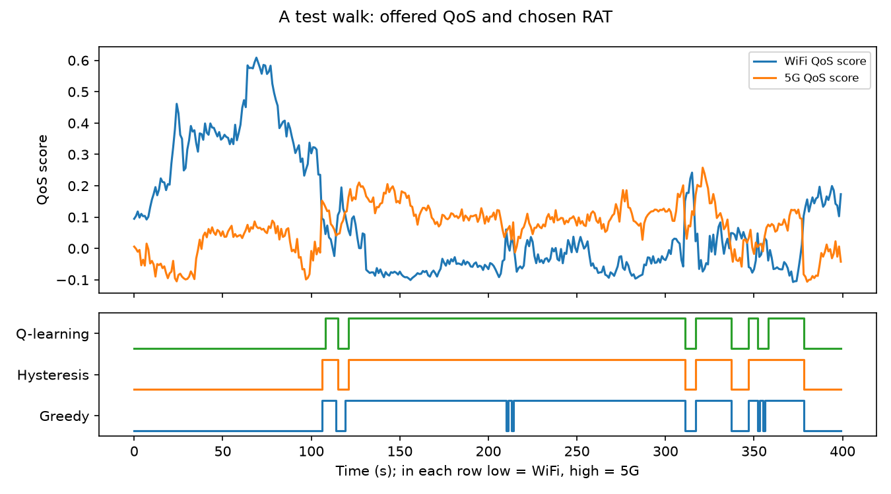
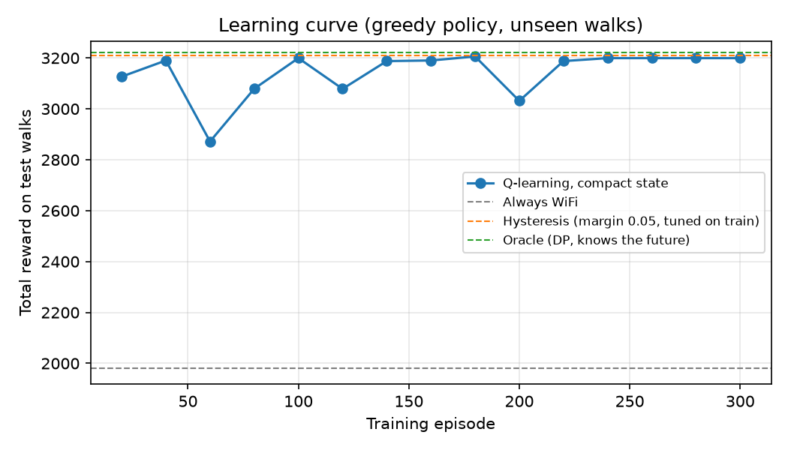

# Q-Learning Based Vertical Handover Decision Algorithm (VHDA)

**Author** Mert - Electrical & Electronics Engineering

A Q-learning agent that decides, every second, whether a mobile user should be on **WiFi** or **5G**, trading QoS (throughput and latency) against the cost of switching.

## Results (on walks the agent never saw)

Trained on 40 simulated walks, tested on 10 other walks of 2000 s each. Handover cost 0.1.

| Policy                                               | Test reward | Of the way to the optimum | Handovers / 1000 s |
| ---------------------------------------------------- | ----------- | ------------------------- | ------------------ |
| Always WiFi                                          | 1979        | 0%                        | 0                  |
| Greedy (best QoS right now)                          | 3167        | 96%                       | 49.6               |
| Hysteresis, margin tuned on the training walks       | 3210        | 99%                       | 20.1               |
| Q-learning, first version's state (8 values rounded) | 1977        | 0%                        | 5.9                |
| **Q-learning, compact state**                        | **3199**    | **98%**                   | **18.9**           |
| Optimum (dynamic programming, knows the future)      | 3222        | 100%                      | 16.0               |

All 5 seeds give the same result (3199.4). Full table: [`Results/results.md`](Results/results.md).

- The agent reaches **98% of the optimum** on unseen walks with **2.6× fewer handovers** than greedy selection.
- It learns a hysteresis-like rule **without being told the margin**; a hysteresis rule whose margin was tuned on the same training data is still slightly better (0.3%). In this setting the best decision depends almost only on the present, so a well-tuned rule is hard to beat; see _What next_.
- The first version's state (8 values rounded to 2 decimals) gave **133,788 different states**: the agent memorised the training walks (train reward 11,539, not far from the others) and on new walks fell back to "always WiFi".



Greedy switches back and forth on small fluctuations (around 210 s and 355 s); Q-learning and hysteresis stay.



## What I learned

The first version trained and evaluated on the same 10,000 rows and reported first vs. last training episode ([`Results/v1`](Results/v1)). Looking closer:

1. **The agent memorised the data.** Rounded to 2 decimals, 9,999 of 10,000 rows were different states. On the same rows in a different order it did worse than always choosing WiFi.
2. **The dataset had no time structure.** Consecutive rows were independent (lag-1 autocorrelation ≈ 0) and the better network changed every other second. Handover is a sequential problem only because conditions change slowly as the user moves; without that there was nothing to learn but the rows.
3. **The agent did not know which network it was on**, although the reward depended on it.

The changes: a mobility simulator with time-correlated signals, train/test on different walks, the serving network in the state, a 20-state compact representation, the baselines and the optimum for comparison, and a decaying learning rate (with a constant one the learned policy kept collapsing for a few episodes at a time).

## Why reinforcement learning?

Vertical handover is a **sequential decision-making problem**: frequent handovers degrade performance, and whether a switch pays off depends on how conditions develop after it. Q-learning learns such a policy from interaction, without labelled "correct" decisions.

## Data: simulated walks

[`src/traces.py`](src/traces.py) simulates a user walking in and around a building, one sample per second:

- **Movement:** random waypoint at 0.8–1.6 m/s with pauses, in a 100 m × 60 m area; the building covers 60 m × 40 m of it.
- **WiFi:** access point inside the building; log-distance path loss (exponent 2.8), 12 dB wall loss outside, shadowing correlated over 5 m.
- **5G:** a cell about 450 m away; path loss exponent 3.2, 10 dB penetration loss inside, shadowing correlated over 20 m.
- **Load:** each network's load drifts slowly (AR(1)); it adds interference, cuts throughput and adds queueing delay.
- **Throughput** from Shannon capacity × (1 − load), capped at 300 Mbit/s; **latency** from a base delay, retransmissions at low SINR, queueing and jitter.

Values are normalised to 0–1 with fixed physical ranges, so every walk uses the same scale. Consecutive samples are strongly correlated (lag-1 autocorrelation 0.92–0.97) and the better network changes about 5 times per 100 s.

The old dataset (`Datasets/vhda_synthetic_normalized.csv`) can still be loaded with `VHDAEnv(csv_path=..., split="train" | "test")`.

## Environment, state, action, reward

- **Observation (9):** RSSI/SINR/throughput/latency of WiFi, RSRP/SINR/throughput/latency of 5G, and the serving RAT.
- **Action:** `0` WiFi, `1` 5G.
- **Reward per second:** QoS score of the chosen RAT (`0.7 × throughput − 0.3 × latency`), minus the **handover cost** when the RAT changes.
- **Unnecessary handover** (metric): a switch after which the new RAT is not better than the old one by more than 0.05 at that moment.
- **Agent state:** how much better 5G is than WiFi now (10 bins) × serving RAT = 20 states.

Because the reward depends only on the present scores and the previous RAT, the best possible action sequence for a walk can be computed exactly by dynamic programming ([`src/baselines.py`](src/baselines.py)); that is the 100% line.

## Project structure

```
src/
 ├── traces.py     # mobility simulator: walks -> normalised measurements
 ├── env.py        # Gymnasium environment
 ├── agent.py      # tabular Q-learning, compact and rounded states
 ├── baselines.py  # always-WiFi/5G, greedy, hysteresis, dynamic-programming optimum
 ├── evaluate.py   # runs a policy over every walk of an environment
 └── run.py        # trains, compares on the test walks, writes Results/
Results/           # results.md, test_walk.png, learning_curve.png; v1/ = first version
Datasets/          # the original synthetic CSV
```

## How to run

Python 3.9+.

```
git clone https://github.com/mertiodas/vhda.git
cd vhda
python -m venv venv
source venv/bin/activate          # Windows: venv\Scripts\activate
python -m pip install -r requirements.txt

python src/run.py                 # full run, about 20 s
python src/run.py --quick         # smaller
python src/run.py --seed 3 --handover-cost 0.2
```

The table is printed and written to `Results/results.md` with the two figures.

## What next

- **Anticipation:** add the recent trend of the score difference (or the user's speed) to the state. That is where an RL agent can beat a fixed-margin rule: switching early when one network is clearly fading.
- **Real measurements:** the simulator is a stand-in. Next is logging WiFi and 5G with two Android phones on fixed routes and training on those traces.
- **Function approximation (DQN)** on the raw 9 values instead of bins.
